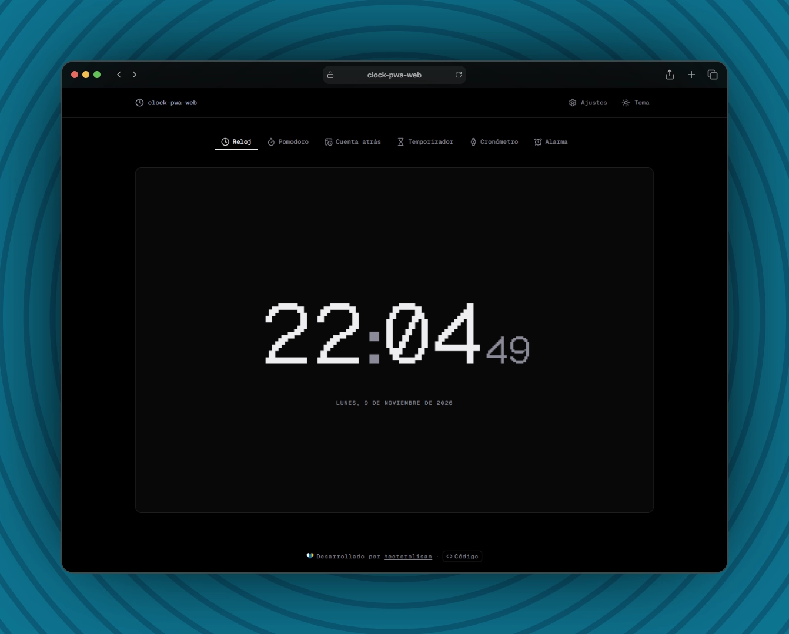

# Clock (clock-pwa-web)

Installable clock PWA: digital clock, pomodoro, countdown, timer, stopwatch and alarms in a single page.
Timers keep running across tab switches and reloads, and work offline once installed.

- **Astro 7** — static site with a single Preact island (`client:only`), no backend.
- **Preact** (`compat`) + **@preact/signals** — UI and global settings shared across islands.
- **Tailwind CSS 4** + **shadcn/ui** (Radix) — utility styling and UI components.
- **@vite-pwa/astro** — service worker, manifest, icons and app shortcuts.
- **Fontsource** — self-hosted Geist, Geist Mono and Geist Pixel fonts.
- **Vitest** + **Testing Library** — unit tests; **Oxlint** + **Prettier** — linting and formatting.
- **pnpm** — package manager.

> Live demo: [hectorolisan.github.io/clock-pwa-web](https://hectorolisan.github.io/clock-pwa-web/)

> Alarms only ring while the app is open (tab or backgrounded PWA): the web cannot wake the device without a push server.



## Tools

| Tab          | Hash         | Description                                                                                 |
| :----------- | :----------- | :------------------------------------------------------------------------------------------ |
| Reloj        | `#clock`     | Digital clock with 12/24 h and seconds settings, plus a world clock for one extra time zone |
| Pomodoro     | `#pomodoro`  | Work/break cycles with configurable durations, auto-start and daily cycle counter           |
| Cuenta atrás | `#countdown` | Countdown to a target date and time                                                         |
| Temporizador | `#timer`     | Up to 6 timers running at the same time, with presets and +1 min                            |
| Cronómetro   | `#stopwatch` | Stopwatch with laps (best/worst split), CSV export and copy                                 |
| Alarma       | `#alarm`     | Up to 3 alarms with sound and system notification                                           |

- **Tabs** are synced with the URL hash, so each tool can be bookmarked or opened from the PWA shortcuts.
- **Persistence**: state is saved in `localStorage`; timers store their end timestamp (`endAt`), so they survive reloads.
- **Alerts**: synthesized Web Audio sounds (xylophone, bell, digital, soft) with adjustable volume + system notification, with a global banner in the app.
- **Status**: the running tool shows its remaining time in the tab title and a progress ring in the favicon, and keeps the screen on (Screen Wake Lock).
- **Keyboard**: `Space`/`K` start/pause, `R` reset, `L` lap, `N` skip pomodoro phase, `1`–`6` switch tab.
- **Theme**: light/dark mode and primary color picker from the Tailwind palette (`#333b4b` by default).
- **Languages**: Spanish and English, detected from the browser and switchable in settings.
- **Accessibility**: `aria-live` announcements, `role="timer"`, keyboard hints, reduced motion and WCAG AA contrast.

## Project Structure

```
/
├── public/
│   ├── cover.webp
│   ├── favicon.svg              # Source for the generated PWA icons
│   └── robots.txt
├── src/
│   ├── assets/svg/
│   │   └── Heart.astro
│   ├── components/
│   │   ├── ui/                  # shadcn/ui components
│   │   ├── views/
│   │   │   ├── AlarmView.tsx
│   │   │   ├── ClockView.tsx
│   │   │   ├── CountdownView.tsx
│   │   │   ├── PomodoroView.tsx
│   │   │   ├── StopwatchView.tsx
│   │   │   └── TimerView.tsx
│   │   ├── App.tsx              # Hash-synced tabs + global alert banner
│   │   ├── Display.tsx          # Time display
│   │   ├── Settings.tsx         # 12/24 h and seconds settings
│   │   └── TimeDialog.tsx       # Time picker dialog
│   ├── hooks/
│   │   ├── useNow.ts            # Current time ticker
│   │   ├── useShortcuts.ts      # Per-view keyboard shortcuts
│   │   └── useStored.ts         # localStorage-persisted state
│   ├── layouts/
│   │   └── Layout.astro
│   ├── lib/
│   │   ├── alert.ts             # Web Audio sounds + notification
│   │   ├── announce.ts          # aria-live announcer
│   │   ├── i18n.ts              # es/en dictionaries + t()
│   │   ├── settings.ts          # Global settings signal
│   │   ├── status.ts            # Tab title, favicon progress and wake lock
│   │   ├── theme.ts             # Primary color
│   │   ├── time.ts              # Time formatting and time zones
│   │   ├── timer.ts             # Pure countdown, pomodoro, alarm and lap logic
│   │   ├── title.ts             # Browser tab title
│   │   └── utils.ts
│   ├── pages/
│   │   └── index.astro          # Header + App island + Footer
│   ├── sections/
│   │   ├── Footer.astro
│   │   └── Header.astro
│   ├── styles/
│   │   └── global.css           # Tailwind + theme tokens
│   ├── env.d.ts
│   └── pwa.ts                   # Service worker registration
├── .oxlintrc.json
├── .prettierrc.json
├── AGENTS.md
├── astro.config.mjs             # Preact + PWA manifest
├── components.json              # shadcn/ui config
├── LICENSE
├── package.json
├── tsconfig.json
├── vitest.config.ts
└── README.md
```

## Available Scripts

| Command        | Action                                                 |
| :------------- | :----------------------------------------------------- |
| `pnpm install` | Install all dependencies                               |
| `pnpm dev`     | Start dev server at `localhost:4321`                   |
| `pnpm build`   | Build into `./dist/` with service worker and manifest  |
| `pnpm preview` | Preview the production build (installable/offline PWA) |
| `pnpm lint`    | Run Oxlint                                             |
| `pnpm format`  | Format with Prettier (`format:check` to verify)        |
| `pnpm test`    | Run Vitest                                             |

> You can also use `npm` or `bun` if you prefer.
